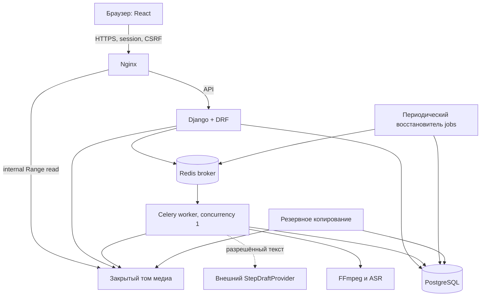

# Архитектура и технические решения

[К полному плану](00-overview.md)

## Предлагаемый стек

Выбор предварительно сделан под небольшую команду и наличие обработки видео на Python. Если у команды сильнее другой стек, менять решение до начала серверной реализации, сохраняя контракты и инварианты.

| Слой | Решение | Причина |
|---|---|---|
| Интерфейс | React 19, TypeScript, Vite, обычный HTML video | Один адаптивный клиент, явные типы, готовый браузерный плеер |
| Сервер | Python 3.12, Django 5.2 LTS, Django REST Framework 3.16 | Авторизация, ORM, миграции и служебная админка без самостоятельного изобретения |
| Данные | PostgreSQL 17 | Транзакции, ограничения, JSONB для снимков и индексируемый поиск |
| Фоновые задания | Celery 5.6 и Redis как брокер | Обработка отделена от HTTP; статусы и надёжность задаются приложением |
| Файлы D0/D1 | Закрытый диск сервера через StorageAdapter | Простое контролируемое начало, без дополнительного S3-сервиса |
| Выдача видео | Nginx internal location после проверки Django | Диапазоны байтов и разгрузка Python; файл не открыт как публичная статика |
| Медиа | FFmpeg/FFprobe в ограниченном worker | Проверка, нормализация, аудио и обложка |
| ASR | Адаптер; стартовая оценка Whisper small multilingual | Уже есть локальный runtime; качество на материалах пилота измеряется |
| Черновик шагов | StepDraftProvider с JSON-контрактом | Провайдер заменяем, отключаем и не получает полномочий приложения |
| Тесты | pytest + Django/DRF, frontend unit tests и Playwright | Проверка правил сервера, ключевых состояний интерфейса и сквозного пути |
| Поставка | Один репозиторий; Docker Compose для тестового сервера | Без Kubernetes и микросервисной инфраструктуры на старте |

На дату проверки Django 5.2 LTS поддерживается до апреля 2028 года; DRF 3.16 заявляет поддержку Django 5.2. React публикует текущую ветку 19, Node.js 24 и 26 указаны как LTS. Для frontend выбираем Node 24 LTS. Точные совместимые patch-версии фиксируются lock-файлами в T006/T007, перед этим проверяются security advisories. [Django](https://www.djangoproject.com/download/), [DRF](https://www.django-rest-framework.org/community/3.16-announcement/), [React](https://react.dev/versions), [Node.js](https://nodejs.org/en/about/previous-releases).

## Топология



Это один модульный сервер и один worker из общего кода. Redis не является источником состояния задания. Browser никогда не получает ключ провайдера, путь файловой системы или право изменять статус обработки.

## Структура будущего репозитория

```text
master-experience/
  docs/                         # текущий план
  backend/
    config/                     # settings, urls, celery, health
    accounts/                   # пользователь, сессии, приглашения
    organizations/              # участники, роли, лимиты
    instructions/               # черновик, шаги, публикация, версии
    media_assets/               # upload, проверка, закрытая выдача
    processing/                 # jobs, стадийная обработка, адаптеры
    search/                     # только разрешённые текущие публикации
    feedback/                   # замечания к публикации
    audit/                      # события, не полный контент
    tests/                      # интеграционные и permission tests
  frontend/
    src/app/                    # маршруты, сессия, error boundary
    src/features/               # library, upload, editor, review, reader
    src/api/                    # клиент и сгенерированные типы OpenAPI
    src/components/             # небольшие общие компоненты
    src/styles/
  contracts/                    # экспорт OpenAPI, JSON Schema
  fixtures/public-demo/         # собственные демонстрационные материалы
  infra/                        # Compose, Nginx, runbooks
  scripts/                      # проверки, backup/restore, экспорт docs
```

Эти каталоги описывают будущую реализацию. Пока создана документация, остальные файлы должны появляться в соответствующих задачах, а не как пустые заглушки всего проекта.

## Правила модулей

Views разбирают запрос, проверяют вход и вызывают domain service. Services выполняют транзакции, проверяют инварианты и создают события. Query-функции всегда получают явную organization и пользователя. Модели задают constraints; serializer не является единственным местом проверки.

Сервисы публикации, переходов workflow, выдачи медиа и удаления вызываются и из API, и из служебных команд. Служебная Django admin не должна позволять обходить правило неизменяемости published version обычным редактированием полей.

Медиа- и AI-адаптеры возвращают типизированный результат либо контролируемую ошибку. Они не вызывают API публикации и не записывают instruction напрямую. Внешний SDK ограничен одним адаптером, чтобы заменить поставщика без переписывания продукта.

## Сессии и один origin

Production: сайт и `/api/v1/` на одном домене. Сессия Django в защищённой HttpOnly cookie; CSRF-токен нужен для изменяющих запросов. Login/logout/reset обрабатываются с явной CSRF-защитой, включая anonymous login. Обычный DRF SessionAuthentication сам по себе не заменяет защиту login endpoint. Dev Vite проксирует `/api` на Django, чтобы не вводить отдельную CORS-схему. [DRF о CSRF](https://www.django-rest-framework.org/topics/ajax-csrf-cors/).

API возвращает стандартизированную 401 для отсутствующей/истёкшей сессии через явную обёртку authentication/error handling; 403 — для аутентифицированного пользователя без права. Это намеренный контракт поверх стандартного поведения DRF, который иначе может возвращать 403 на unauthenticated SessionAuthentication. Проверить это отдельным тестом.

## Жизненный цикл загрузки

1. API создаёт upload session и резервирует место в квоте атомарно.
2. Браузер отправляет файл одним multipart HTTP-запросом по upload_id.
3. Поток идёт на временный диск, а не в RAM. Сервер ограничивает фактическое число байтов, считает SHA-256 и не доверяет Content-Type/имени клиента.
4. После окончания сервер закрывает файл, атомарно перемещает его в карантинный UUID-путь и фиксирует MediaAsset + ProcessingJob в транзакции.
5. После commit запускается задача через `on_commit`; восстановитель периодически подбирает jobs, которые созданы, но не отправлены/не выполняются.
6. При обрыве session становится expired/cancelled; резерв снимается. Временные файлы убирает отдельная очистка. Готовый asset не меняется повторным upload_id.

D1 не имеет докачки. Если пилот покажет неприемлемые потери на мобильной сети, следующий этап — resumable upload или S3 multipart. Нельзя описывать однопоточный upload как возобновляемый.

## Почему закрытый диск сейчас

При 10–20 коротких роликах можно проверить продукт без инфраструктуры object storage. Интерфейс StorageAdapter изначально включает `write_stream`, `stat`, `read`, `delete`, `internal_delivery_reference`; доменный код не зависит от абсолютных путей. Источники и производные хранятся на постоянном томе, не внутри контейнера.

После пилота S3-совместимый backend потребует отдельной проверки presigned URLs, повторной записи и удаления. Такие ссылки могут повторно использоваться до истечения и перезаписывать объект с тем же ключом; их нельзя считать одноразовыми. Поэтому при миграции нужны уникальные staging keys и фиксация проверенной версии объекта. [Документация S3](https://docs.aws.amazon.com/AmazonS3/latest/userguide/using-presigned-url.html).

## Поиск D1

Индексируется только current published snapshot: название, цель, названия/описания шагов, утверждённый текст при его наличии. Сначала фильтр организации и активности публикации, затем поиск. Для малого объёма — PostgreSQL полнотекстовый поиск с конфигурацией `simple`, нормализация Unicode NFC и lowercase; trigram-поиск для опечаток после оценки на наборе RU/KK. Не обещать морфологический анализ казахского простым `simple`.

Индекс обновляется в той же транзакции, что current_version. При отзыве удаляется сразу; внешней поисковой системы в D1 нет. [pg_trgm](https://www.postgresql.org/docs/current/pgtrgm.html) предоставляет сравнение строк и индексы сходства; конкретное ранжирование — решение проекта.

## Надёжность заданий

Доставка Celery может повторяться. У ProcessingJob есть id, stage, state, lease_token, lease_expires_at, heartbeat_at, attempts, cancel_requested и input_hash. Worker захватывает job условным UPDATE; повторный worker получает no-op, если lease действителен или job уже завершён. Перед каждой фиксацией проверяет lease_token и актуальность объекта. Производные файлы пишутся в attempt-папку и публикуются атомарно только владельцем актуального lease.

Стадии имеют собственные входные хэши и результат. Уже валидный артефакт можно переиспользовать; изменённый источник/настройки требуют нового задания. `acks_late` допустим только при реализованной идемпотентности и не заменяет обработку исключений, `retry`, timeout и восстановитель. [Celery tasks](https://docs.celeryq.dev/en/stable/userguide/tasks.html).

## Архитектурные границы первого этапа

Одна база, общий backend, один media worker, один хост для пилота с отдельной резервной копией. Отказоустойчивость без простоя, автоматическое горизонтальное масштабирование и zero-downtime migration не обещаются. Сначала доказать ценность, затем разделить media worker и web на разные узлы при измеренном узком месте.
