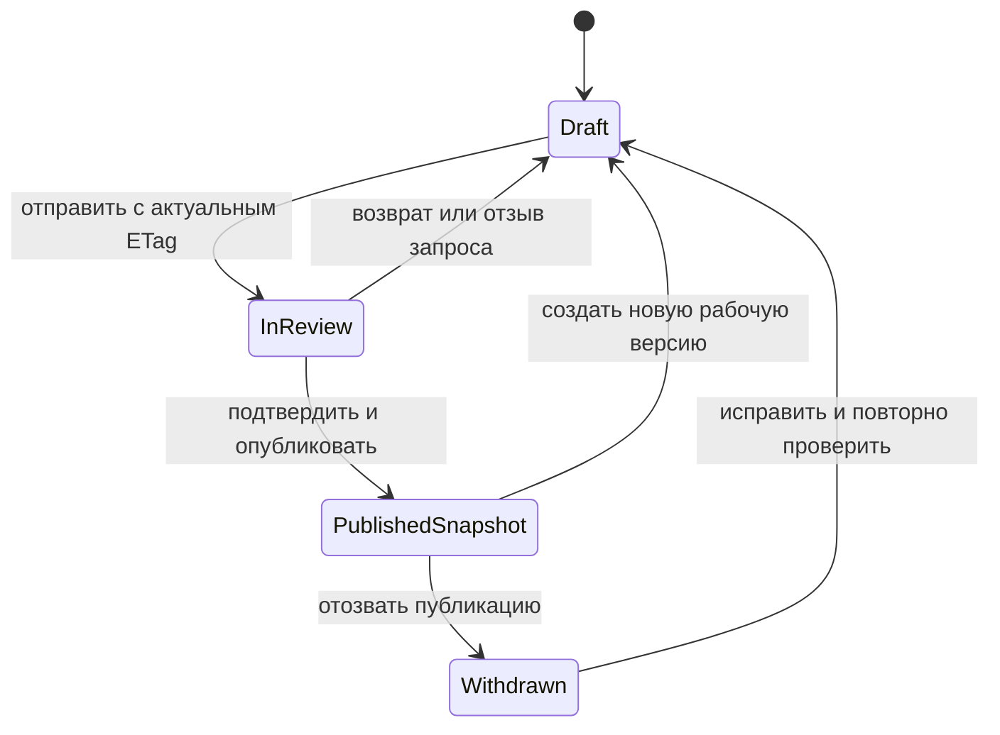

# Данные, ограничения и состояния

[К полному плану](00-overview.md)

## Общие соглашения

UUID для публичных идентификаторов; timezone-aware timestamp в UTC; время внутри видео — integer milliseconds, не floating point. Строки нормализуются Unicode NFC, но оригинальное имя файла сохраняется только как отображаемое значение. Файл на диске получает UUID-путь. UUID не заменяет контроль доступа.

Tenant-сущности имеют `organization_id`, `created_at`, `updated_at`. Проверяются и принадлежность пользователя, и принадлежность всех связанных объектов одной organization. Для критичных связей создаются составные FK через миграцию `(organization_id, referenced_id)` на уникальную пару, либо эквивалентное ограничение БД; простая serializer-проверка не считается достаточной для job/asset/version. Выбранный способ зафиксировать в T010.

## Таблицы

### User и Organization

`User`: id UUID, email unique case-insensitive, display_name varchar(120), password hash средствами Django, is_active, created_at, last_login. Своя модель пользователя задаётся до первой миграции. Пароли, reset tokens и session cookies не помещаются в audit payload.

`Organization`: id, name varchar(120), status active/suspended/deleting/deleted, timezone default Asia/Almaty, external_ai_enabled false, storage_quota_bytes, upload_quota_bytes, storage_used_source_bytes, storage_reserved_source_bytes, daily_ai_limit_units, created_by. Лимиты и счётчики ≥ 0. Резерв и использование обновляются под блокировкой строки организации; свободное место диска с производными проверяется отдельно. При suspended сохраняется доступ оператора к обслуживанию, но обычные пользователи не получают новые материалы/задания.

`Membership`: id, organization_id, user_id, role enum admin/author/reviewer/reader, is_active, joined_at, revoked_at. UNIQUE(org,user). Изменение последнего активного admin блокируется транзакцией с блокировкой строк admin-memberships. Роль не принимается из cookie или содержимого JWT.

`Invitation`: id, organization_id, email_normalized, role, token_digest, expires_at, accepted_at, revoked_at, created_by. Сырой криптографически случайный token возвращается/отправляется только один раз. Погашение атомарно; повтор не создаёт второго участника. TTL по умолчанию 72 часа.

### Загрузка и медиа

`UploadSession`: id, org, created_by, instruction_id, expected_size_bytes, received_size_bytes, original_filename, language, state initialized/uploading/completed/cancelled/expired/failed, expires_at, quota_reserved_bytes, idempotency_key, content_hash. TTL незавершённой session — 2 часа; завершённая хранит связь с asset. Один завершённый asset на session. Квота резервируется до передачи и освобождается один раз.

`MediaAsset`: id, org, upload_session_id unique, created_by, original_key, original_size_bytes, sha256, detected_container, detected_video_codec, detected_audio_codec nullable, duration_ms nullable, width, height, rotation, has_audio, status quarantined/validating/ready/rejected/deleting/deleted, deletion_requested_at, deleted_at. READY означает, что доступная для просмотра производная создана; оригинал сам по себе не публикуется.

`MediaArtifact`: id, org, asset_id, kind playback/audio/thumbnail, storage_key, bytes, sha256, generation, state writing/ready/deleting/deleted, created_by_job_id. UNIQUE(asset,kind,generation); сервер выбирает актуальный ready artifact. Аудио не выдаётся reader отдельной ссылкой. Не переиспользовать один storage_key для разных поколений.

### Обработка и расшифровка

`ProcessingJob`: id, org, instruction_id, asset_id, requested_by, kind prepare_media/transcribe/draft_steps/delete_asset, state queued/running/succeeded/failed/cancelled, stage, attempts, max_attempts, input_hash, config_version, provider_model, lease_token, lease_expires_at, heartbeat_at, cancel_requested, error_code, error_summary, queued_at, started_at, completed_at. Частичный unique constraint запрещает две активные job одного kind/input_hash/asset. Instruction и asset должны быть связаны в той же organization; job не выбирает инструкцию по косвенному совпадению имени файла. Аргументы задачи в broker — только job_id, не сырой контент.

`Transcript`: id, org, asset_id, source_job_id, language_requested, language_detected nullable, status draft/reviewed, revision integer ≥1, provider, model, config_version, text_hash. Одна актуальная выбранная расшифровка asset; повторное распознавание создаёт отдельный Transcript, не стирает старый.

`TranscriptSegment`: id, org, transcript_id, ordinal, start_ms, end_ms, raw_text, corrected_text nullable, uncertainty_reason nullable. UNIQUE(transcript,ordinal); CHECK(start≥0, end>start). Согласование end≤asset.duration проверяет service в транзакции, так как CHECK не может обращаться к другой таблице. Правка corrected_text увеличивает transcript.revision; raw_text неизменяем.

`DraftProposal`: id, org, instruction_id, job_id unique, based_on_working_revision, based_on_transcript_id, based_on_transcript_revision, schema_version, payload JSONB, warnings JSONB, status available/applied/discarded, created_at. Payload хранит предложенные шаги; применение возможно только при совпадающих ревизиях. Иначе пользователь может открыть предложение и перенести полезное вручную. Источник истины для публикации — рабочая версия после принятия человеком.

### Инструкция и рабочая версия

`Instruction`: id, org, owner_id, source_asset_id nullable unique, lifecycle active/archived/deleting/deleted, current_version_id nullable, published_search_text, created_at, updated_at, deleted_at. До загрузки source отсутствует; один source asset принадлежит одной инструкции в D1, что закреплено unique constraint. current_version_id может ссылаться только на версию этой же инструкции и организации. При замене исходного ролика создавать новую инструкцию; перенос таймкодов старого видео автоматически запрещён.

`WorkingCopy`: id, org, instruction_id unique, revision integer, is_open bool default true, title varchar(120), purpose varchar(600), language enum ru/kk/mixed, workflow draft/in_review, transcript_id nullable, transcript_revision nullable, review_requested_by, review_requested_at, based_on_version_id nullable. Единственный активный черновик на instruction. Увеличивать revision на каждом изменении текста, шагов, отметок проверки или workflow. API возвращает ETag с этим значением. is_open=false после публикации запрещает изменение до явного create-draft.

`WorkingStep`: id, org, working_copy_id, ordinal, title varchar(120), description text ≤2000, start_ms, end_ms, origin manual/ai/ai_edited, evidence_segment_ids JSONB, evidence_transcript_revision nullable, warning_codes JSONB, checked_by nullable, checked_at nullable. UNIQUE(copy,ordinal) deferrable для перестановки. От 1 до 30 шагов перед публикацией. Источники разрешены только из transcript того же asset. Все referenced IDs проверяются; JSONB не исключает эту обязанность. Изменение шага очищает checked_by/checked_at. Перестановка инвалидирует общую проверку последовательности.

`ReviewComment`: id, org, working_copy_id, working_revision, step_id nullable, author_id, text, blocking bool, status open/resolved, resolved_by, resolved_at. Удалённый шаг не удаляет комментарий; он остаётся связан с revision и отображается как относящийся к прошлому состоянию. Снятие blocking требует reviewer/admin; author может ответить, но не скрыть блокер.

### Публикация

`PublishedVersion`: id, org, instruction_id, version_number integer, source_asset_id, snapshot JSONB, content_sha256, source_working_revision, published_by, published_at. UNIQUE(instruction,version_number). Snapshot содержит заголовок, цель, язык, точный порядок и текст шагов, время, источники и подтверждения на момент публикации. Поля содержимого после создания не изменяются ни API, ни admin. Отзыв записывается отдельно; физическое удаление при удалении инструкции допускается по политике данных.

`PublicationEvent`: id, org, instruction_id, version_id, action published/withdrawn/restored_as_new, actor_id, reason nullable, created_at. `current_version_id=NULL` скрывает публикацию; старая версия не становится автоматически текущей при отзыве. Restore — создание нового черновика и новая публикация, а не переписывание истории.

### Обратная связь и служебные данные

`Feedback`: id, org, instruction_id, version_id, snapshot_step_id nullable, reporter_id, category inaccurate/outdated/technical/other, body, state open/in_progress/resolved, resolution nullable. Ссылка на step — стабильный ID в snapshot, не на изменяемый WorkingStep. Зафиксированная версия не меняется при новой публикации.

`AuditEvent`: id, org nullable, actor_id nullable, action, object_type, object_id, request_id, job_id nullable, metadata JSONB с allowlist, created_at. Не записывать полный transcript, prompt, пароль, key, reset/invite token или сырой URL с credentials.

`IdempotencyRecord`: id, org, actor_id, route, key, request_hash, state in_progress/completed/failed, response_status, response_json, expires_at. UNIQUE(org,actor,route,key). TTL 24 часа. Та же key + другой body → 409; совпадение → прежний результат. Большие ответы и file content сюда не копируются.

`DeletionRecord`: id, org, instruction_id nullable, asset_id nullable, requested_by, requested_at, state pending/running/completed/failed, retry_at, last_error, completed_at. Минимальная tombstone с ID и временем живёт дольше основных backups; после восстановления применяется до открытия доступа.

Реализация T050 в `backend/ai_budget/` расширяет исходный план дневного счёта. `BudgetAccount`: строковый key (unit/scope/период), unit, reserved, spent, blocked, updated_at. Счета покрывают сеанс, организацию за день/месяц UTC и платформу за день UTC. Суммы — целые USD microdollars; `1 USD = 1 000 000`. `blocked` сохраняется при расходе выше проверенной оценки.

`AIUsageReservation`: UUID, org, session_id, job_id, attempt, call_key, provider, model, unit, pricing_version, pricing_snapshot, max_units, actual_units nullable, state, account_keys, usage, provider_request_id и timestamps. UNIQUE(job,attempt,call_key); состояния reserved/dispatched/settled/unknown/released. Дополнительно повтор `(job,call_key)` между попытками запрещён, если предыдущий резерв не released. Неизвестный исход нельзя считать бесплатным и отправлять автоматически снова.

| Уровень | Квота обращений | Денежный предел проверенного API-профиля |
|---|---|---|
| Сеанс/анализ | 30 по умолчанию, максимум 60 | $2 по умолчанию, максимум $5 |
| Организация, день UTC | 100 | $10 |
| Организация, месяц UTC | 2 000 | $100 |
| Платформа, день UTC | 500 | $50 |

Это внутренние потолки, не клиентские тарифы или разрешение списать деньги с карты. `AI_BUDGET_ENABLED=0` запрещает новые обращения, а не отключает учёт для продолжения запросов. Платный вызов расходует и квоту обращений, и денежный резерв. Preflight проверяет доступный бюджет всего первого обзора, но не резервирует всю очередь: перед каждым вызовом действует отдельная атомарная проверка.

Денежная оценка разрешена только для `gpt-5.4-mini` на `https://api.openai.com/v1`, версия `openai-gpt-5.4-mini-2026-11-01`. Верхняя оценка для 12 JPEG: 32 768 UTF-8 байт текста как консервативная граница текстовых токенов + 2 048 на протокол + 12 × 1 080 на изображения + 8 192 выходных токена. По ставкам $0,75/$4,50 за миллион это **$0,072696 резерва на вызов**, не его фактическая цена. Скидка кеша не предполагается. [Изображения и токены](https://developers.openai.com/api/docs/guides/images-vision).

Неизвестная модель, тариф NVIDIA или иной endpoint блокируются с `AI_PRICING_UNAVAILABLE`. Codex учитывается как subscription_calls, локальный Ollama на loopback — local_calls, по одному обращению с денежными полями null. Это не нулевая себестоимость и не оценка остатка подписки.

### Реализованный бюджет и проект экономики

1 ноября 2026 · рабочая гипотеза для проверки: небольшие B2B-команды платят подписку с включённым объёмом анализа. Аудитория и цена пользователем ещё не выбраны. Внутренний ledger, атомарные резервы и ограничения реализованы; кеш между запусками, клиентские тарифы и платёжный billing остаются проектом. Codex-мост остаётся персональным локальным тестом, не способом обслуживать платных клиентов.

**Единица анализа** — один ограниченный пакет: до 12 кадров из фрагмента до 60 секунд, с заданными сервером пределами входных и выходных токенов для конкретной модели. Минуты видео сами по себе не задают стоимость: изображения, разрешение, число повторных просмотров и размер ответа могут различаться. Длинный ролик разбивается на пакеты; до запуска показываются их число и расход включённой квоты. `unit` клиента и денежные `limit_units` ledger — разные величины: последние хранят целые минимальные расчётные единицы валюты, не float.

Анализ сохранённого видео запускается отдельным действием автора. Полный режим сначала обрабатывает все обзорные окна по 30 секунд, затем при наличии бюджета делает один уровень уточнений до 15 секунд. Готовые checkpoints сохраняются и не требуют повторного запроса при продолжении того же задания.

Ещё не реализованная экономия live: максимум один вызов за 30 секунд / 20 вызовов на 10 минут, локальный отсев одинаковых кадров и короткие пакеты при изменении сцены. Проверить на эталоне, что фильтр не пропускает медленное действие. Сейчас действуют прежние технические пределы 8 секунд / 60 вызовов, дополненные ledger-квотой сеанса по умолчанию 30. Сервер принимает до 300 уникальных live-кадров, но один кадр может входить в несколько запросов.

Общий кеш разных запусков тоже остаётся проектом: ключ `org + source/frame hashes + window + sampling version + language + mode + prompt/schema version + exact model`, проверка прав и доступности кадров обязательна. Checkpoints одного задания не являются таким кешем. Редактирование черновика не должно автоматически запускать модель.

**Денежный барьер перед внешним вызовом реализован:**

- Короткая атомарная транзакция в стабильном порядке проверяет `spent + reserved + max_call <= limit` на всех уровнях и резервирует суммы условными обновлениями. Во время сети транзакция не удерживается. Это работает и в SQLite без row locks; PostgreSQL-конкурентность ещё требует отдельной приёмки.
- API receipt сохраняет usage и идентификатор запроса до проверки JSON/смысла. Settlement идемпотентно переносит фактический расход и освобождает остаток. Отмена или потеря lease не отключает callback учёта: поздний ответ может быть платным, хотя предложение уже нельзя сохранить.
- До отправки отменённый вызов может стать `released`. После dispatch отсутствие достоверного usage, timeout или обрыв оставляют `unknown` с полным резервом. Убийство локального процесса/HTTP future не доказывает отмену у провайдера. Поздний receipt может закрыть unknown; иначе нужна сверка, автоматического возврата нет.
- Каждый новый логический вызов имеет отдельный резерв; неизвестный уже отправленный `(job,call_key)` не повторяется между попытками. Ошибочный JSON не считается бесплатным. Если usage превысил оценку, расход записывается, затронутые счета блокируются для следующих вызовов; уже понесённую стоимость это не отменяет.

В OpenAI сохраняются разрешённые `prompt_tokens`, `completion_tokens` и request id; расчёт консервативно не вычитает кеш. [Схема usage](https://developers.openai.com/api/reference/resources/chat/subresources/completions/methods/create). Полные запросы, изображения и ключи в ledger не записываются. Codex JSONL может содержать токены, но текущий ledger подписки считает вызовы, а не денежный чек или остаток подписки. [Формат CLI](https://learn.chatgpt.com/docs/non-interactive-mode). Для NVIDIA ещё нужны проверенные usage и тарифы.

Второй рекомендуемый уровень защиты — отдельный provider project с денежным пределом и уведомлениями; его настройка ещё не выполнена. Применение лимита может запаздывать, поэтому он не заменяет внутренний резерв и не гарантирует мгновенную остановку уже отправленных запросов. [Spend limits](https://developers.openai.com/api/docs/guides/spend-limits).

### Сценарии стоимости для проверки гипотезы

Для примера используем опубликованные ставки GPT-5.4 mini: $0,75 за 1 млн входных токенов и $4,50 за 1 млн выходных токенов, без предположения о скидке за кеш. [Официальная карточка модели](https://developers.openai.com/api/docs/models/gpt-5.4-mini), проверена 1 ноября 2026. Ставки следует сохранять с версией и перепроверять перед коммерческим запуском.

| Условный объём | Расчёт только модели |
|---|---|
| Один запрос: 16 000 входных токенов, включая изображения, + 2 000 выходных | `16000 / 1000000 × 0,75 + 2000 / 1000000 × 4,50 = $0,021` |
| 10 таких запросов за 10 минут | `$0,21` |
| 20 таких запросов за 10 минут | `$0,42` |

16 000 входных токенов — условие примера, не измерение первого теста с лодкой и не гарантия стоимости любых 12 кадров. В суммах нет отдельного финального анализа, retries, обработки/хранения видео и поддержки. Реальные входные токены изображений нужно измерить и ограничить до выбора тарифа.

Иллюстрация месячного тарифа: $49 чистой выручки на организацию, 100 включённых units, максимум $10 расходов/резервов на ИИ и условные $10 прочих прямых затрат оставляют `$49 − $10 − $10 = $29`, или около 59% маржинального дохода. Это сценарий до постоянных затрат, привлечения клиентов и налогов, не обещание прибыли и не утверждённый ценник. $10 должны покрывать и ошибочные внутренние попытки. Перед обещанием 100 units нужны измерения верхней стоимости unit, лимит повторов и запас; нельзя продавать гарантированную квоту, которую внутренний денежный лимит неожиданно делает недоступной. Модель «безлимитных минут» не закладывается.

Рыночной проверки цены $49 и готовности выбранных команд платить пока нет. Условная точка покрытия постоянных месячных затрат: `fixed_monthly_cost / (net_price − direct_cost_per_customer)`, с округлением числа клиентов вверх и только при положительном знаменателе. Привлечение клиентов (CAC), налоги, отток и сроки оплаты требуют отдельной модели; положительный маржинальный доход одного клиента ещё не означает прибыль бизнеса.

После исчерпания включённого объёма — остановка платного анализа, ручной маршрут и предложение явного пополнения. Покупка дополнительных units требует отдельного подтверждения цены и объёма; автоматическое списание с карты, незаявленные перерасходы и тихое переключение на дорогую модель не предусматриваются.

### Следующие проверки экономики

1. Проверить ledger на разрешённом платном API-запросе, затем PostgreSQL-гонки, смену периода/тарифа и восстановление. Настроить сверку unknown и provider project limits.
2. Измерить стоимость полезной инструкции с учётом отклонённых ответов, уточнений, повторов, видеоCPU/хранения и поддержки на лёгких и тяжёлых рабочих записях.
3. Внедрить и проверить качество экономного live, отсева кадров и кеша внутри организации. Не путать общий кеш с checkpoints одного задания.
4. После измерений утвердить клиентский unit, квоту и цену; добавить явное подтверждение платного пополнения, без скрытого перерасхода или автосписания. Пример тарифа выше не меняет серверные лимиты по умолчанию.

## Индексы

- Membership(org,user,is_active); Invitation(token_digest), (org,email,expires_at).
- Instruction(org,lifecycle,updated_at DESC), (org,current_version_id), GIN индекса поиска.
- WorkingCopy(instruction) unique; WorkingStep(copy,ordinal) unique.
- PublishedVersion(instruction,version_number) unique, (org,published_at).
- Job(org,state,queued_at), (state,lease_expires_at), (asset,kind,input_hash).
- Asset(org,status), Artifact(asset,kind,state), Feedback(org,state,created_at).
- Audit(org,created_at), DeletionRecord(state,retry_at).

Не добавлять индекс на каждое поле без запроса. Размер и план основных SQL проверить на тестовом объёме. Уникальные ограничения и межорганизационные связи проверяются в интеграционных тестах.

## Автомат состояний

PublishedSnapshot — отдельная неизменяемая запись, а не состояние изменяемого WorkingCopy. После публикации WorkingCopy не редактируется, пока команда `create-draft` не сбросит существующую рабочую копию из выбранного snapshot в workflow draft, не выставит is_open=true и не увеличит revision. Отметки проверки сбрасываются; based_on_version_id хранит источник. При отсутствии активного редактируемого черновика API `working-copy` возвращает `editable=false` и ссылку на создание черновика. is_open обязателен в миграции T010.

Правка сегмента расшифровки снимает checked у всех шагов, которые на него ссылаются, добавляет warning `source_changed` и увеличивает working revision. Она не переписывает текст шага и не меняет опубликованный snapshot. Если копия in_review, правку transcript сначала блокировать с требованием вернуть копию в draft. Общая проверка порядка и полноты передаётся в publish confirmations для конкретной ревизии; после перестановки её нельзя переиспользовать от прежней ревизии.

## Транзакция публикации

1. Проверить активную membership и роль reviewer/admin.
2. Заблокировать Instruction и WorkingCopy через SELECT FOR UPDATE.
3. Проверить If-Match, is_open, in_review, asset.ready и отсутствие удаления.
4. Проверить все границы времени, обязательные поля, отмеченные шаги и отсутствие открытых blocking comments.
5. Сформировать канонический snapshot, вычислить hash, создать следующий version_number.
6. Обновить current_version_id и search text, закрыть working copy, записать PublicationEvent/AuditEvent.
7. Commit; вернуть version и ссылку. Два конкурирующих запроса не создают два номера одной публикации.

## Удаление и ссылки

Soft delete сразу исключает инструкцию из списков, поиска и media authorization. Worker отменяет задания и чистит original, playback, audio, thumbnails, transcript, proposals и snapshots. В D1 asset принадлежит одной инструкции; если это изменится, потребуется reference counting и отдельное разрешение на удаление общего файла.

Защищённое чтение медиа проверяет и org, и instruction, и role, и текущую публикацию для reader. Само существование ready artifact не даёт reader доступа к черновику. После успешного hard-delete остаётся минимальная deletion tombstone для предотвращения возврата данных из backup. Политика сроков — документ 07.
